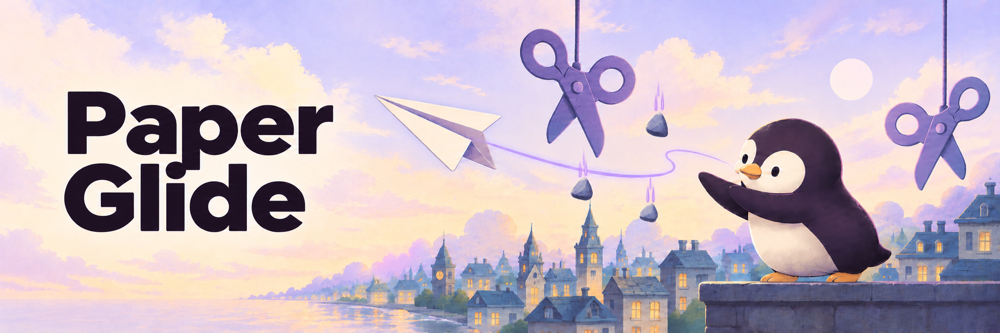

<picture>
  <source media="(prefers-color-scheme: dark)" srcset="assets/banner/paper-glide-dark.png">
  <source media="(prefers-color-scheme: light)" srcset="assets/banner/paper-glide-light.png">
  
</picture>

*Banner illustration generated with AI; the gameplay recording below shows the actual prototype. [Artwork notes](assets/banner/README.md).*

# Paper Glide

### A little paper. A big city. One more try.

Fly through a pixel-art skyline, dodge scissors, and collect stones for points. **Paper Glide** is a small Unity arcade prototype inspired by Flappy Bird, with directional jumps and a rock–paper–scissors twist.

**[Play in your browser](https://pengusto.github.io/paper-glide-web/)** · [Explore the Unity project](https://github.com/pengusto/paper-glide-web/tree/code)


*Existing prototype recording from this repository; it shows early gameplay, not a promise of the current build's performance.*

## Take a flight

Open the browser build and give the game canvas focus. For a first look, use a desktop browser with WebGL support. This is an **early proof of concept**: placeholder art, rough edges, bugs, and long load times are expected. Web performance has not been optimized; mobile input and layout need device testing.

The Unity source defines the following controls. The hosted export may differ from the source branch; these mappings have not been checked in a fresh gameplay session.

| Action | Keyboard | Mouse |
| --- | --- | --- |
| Start a round | Any key | Click |
| Jump up | W or ↑ | Middle button or scroll up |
| Jump down | S or ↓ | Scroll down |
| Jump left | A or ← | Left button |
| Jump right | D or → | Right button |
| End a round | Esc | — |

Scissors end the round; collecting stones increases the score. The source also includes touch/swipe input and a session high score. It does not establish persistent scores or tested mobile support.

## Run the shipped build locally

The default **`main` branch is a static WebGL export**, ready to serve. You do not need Unity to run it. You need Git and Python 3 for this example:

```sh
git clone --branch main --single-branch https://github.com/pengusto/paper-glide-web.git
cd paper-glide-web
python3 -m http.server 8000 --bind 127.0.0.1
```

Open **[http://127.0.0.1:8000](http://127.0.0.1:8000)**. Stop the server with Ctrl+C.

Serve the repository root: `index.html` loads files from both `Build/` and `TemplateData/`. Opening the HTML directly with `file://`, or serving only `Build/`, is insufficient.

| Path on `main` | Purpose |
| --- | --- |
| `index.html` | Unity player, loading bar, and fullscreen control |
| `Build/` | Loader, JavaScript framework, game data, and WebAssembly |
| `TemplateData/` | Player styles and UI images |
| `gameplay.gif` | Existing gameplay preview |

## Inspect or edit the Unity project

The separate **[`code` branch](https://github.com/pengusto/paper-glide-web/tree/code)** contains `Assets/`, `Packages/`, and `ProjectSettings/`. It records **Unity 2022.3.4f1** in `ProjectSettings/ProjectVersion.txt`; `main` cannot be opened as a complete Unity project.

Before reusing or redistributing source assets, review the rights notes below. To work with an authorized local copy, open the `code` branch project in Unity 2022.3.4f1 with WebGL Build Support. The enabled scene is `Assets/Scenes/MainGame.unity`; WebGL exports are made through **File → Build Settings → WebGL**.

The source and hosted export live on separate branches. Rebuilding the source and matching it to the shipped export have not been verified here.

## Credits and reuse

- Prototype by **Enis Uysal** ([pengusto](https://github.com/pengusto)).
- Gameplay inspired by **Flappy Bird**.
- Cityscape credited by the original README to **Free Game Assets**: [Modern City Backgrounds Pixel Art](https://free-game-assets.itch.io/free-city-backgrounds-pixel-art). The source's background license file points to [Craftpix's file licenses](https://craftpix.net/file-licenses/).
- The preview above is the existing `gameplay.gif`; its embedded game art retains its own rights.

**No project-wide license is included.** Public availability is not a blanket permission to reuse the code, build, or artwork. The Unity source includes third-party packages with separate terms. In particular, [`Assets/_External/Feel/license.txt`](https://github.com/pengusto/paper-glide-web/blob/code/Assets/_External/Feel/license.txt) prohibits redistribution of its uncompiled contents while allowing use in a compiled game. Source redistribution rights need clarification; a future license for original project code would not override third-party terms.

## Feedback

Found a reproducible problem? [Open an issue](https://github.com/pengusto/paper-glide-web/issues) with your browser, operating system, whether you used the hosted or local build, and steps to reproduce it. Feature ideas are welcome; this prototype has no promised roadmap.
